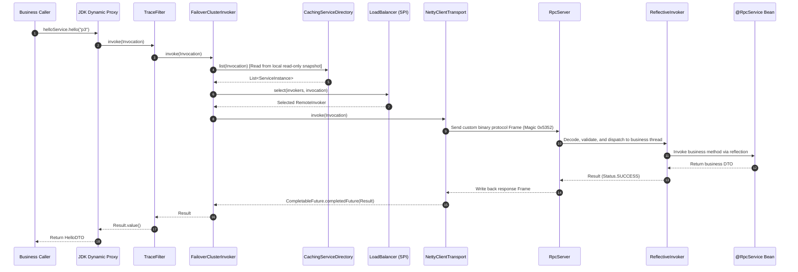

<div align="right">
  <a href="README.md">中文</a> | <strong>English</strong>
</div>

# Small-RPC 2.0

[](LICENSE)
[](https://central.sonatype.com/artifact/io.github.upowerman/small-rpc-spring-boot-starter)
[](https://www.oracle.com/java/)
[](https://netty.io/)
[](https://spring.io/projects/spring-boot)

## 📖 Project Overview

**Small-RPC** is a high-performance, lightweight, and extensible Java RPC framework crafted specifically for in-depth understanding of distributed RPC kernel mechanics.

In version 2.0, the framework underwent a comprehensive modular refactoring and modern microservice governance upgrade:
- **Microkernel Architecture**: Core abstractions are thoroughly decoupled from network transport; `rpc-core` maintains zero dependencies on network protocols or serialization formats;
- **Self-Developed Industrial SPI**: Supports default implementation binding, field dependency injection (with circular dependency detection), and runtime adaptive dynamic dispatching;
- **Event-Driven Registry**: Completely retires the 1.x synchronous pull model in favor of a `Registry` subscribe-push model, combined with `CachingServiceDirectory` local snapshot caching for lock-free reads and **zero-loss degradation during registry failures**;
- **Full Ecosystem Extensions**: Out-of-the-box support for local direct connection, Apache ZooKeeper (Curator 5.6 ephemeral nodes + real-time push), and Redis (Jedis 4.4 Set registry + polling diff push);
- **Graceful Shutdown & Fault Tolerance**: Failover cluster retry, end-to-end Trace context, Spring Boot graceful offline deregistration;
- **Consumer Governance Loop (3.0)**: circuit breaker (dual-condition error/slow-call rate state machine), client rate limiting (token bucket + concurrency semaphore), Fallback degradation, in-flight cap fast-fail — all opt-in, off by default.

> ⚠️ **Learning & Research Positioning**: This project focuses on crystal-clear presentation of core mechanisms and clean engineering design, making it ideal for deeply studying distributed network programming, RPC wire protocols, and service governance.

---

## 📜 Architecture Evolution & 1.0 Review

### 1. Origin & Motivation (October 2019)

Small-RPC was born in **October 2019** (initial commit on `2019-10-09`).

**Original Motivation: To deeply study and demystify the core internals of RPC.**
In the era of microservices, industrial-grade frameworks such as Dubbo, gRPC, and Spring Cloud are immensely powerful but feature massive codebases. Critical low-level mechanics—such as network I/O threading models, binary wire protocol framing/codecs, dynamic proxy stubs, and service registration/discovery—are hidden deep beneath layers of complex abstractions. Beginners often find themselves merely configuring annotations and APIs without truly understanding what transpires over the network during an RPC invocation.

To break this "black box", Small-RPC was built **from scratch**: based on classic Java + Netty + Hessian, manually implementing network communication, dynamic proxies, service export, and remote invocations to form a minimal, readable, and debuggable closed-loop RPC prototype (Small-RPC 1.0).

### 2. 1.0 Minimal Architecture & Mechanics

In version 1.0, the framework prioritized a minimal viable implementation for step-by-step debugging:
- **Monolithic Architecture**: All core logic resided in a single module `small-rpc-core`, encompassing Netty communication, Hessian encoding/decoding, basic registry discovery, and Spring integration;
- **Transport & Serialization**: Utilized Netty 4 NIO channels, directly serializing Java objects to binary streams via Hessian;
- **Manual Spring Factory Wiring**: Configured `RpcSpringProviderFactory` (managing ports, thread pools, and Netty Server bootstrap) and `RpcSpringInvokerFactory` (managing service discovery and client JDK dynamic proxy creation), utilizing `@RpcService` and `@RpcReference` annotations;
- **Basic Registry**: Started with `LocalServiceRegistry` (single-machine static direct-connect / in-memory registry), and later explored basic pull-based registration with Redis and ZooKeeper in v1.1/1.2.

### 3. 1.0 Bottlenecks & Why 2.0

As research progressed and distributed requirements grew, structural bottlenecks in 1.0 emerged, sparking the complete microkernel redesign in 2.0:
1. **Tight Coupling between Core and Protocols**: Core logic was strictly bound to Netty and Hessian, making it impossible to swap transport engines or serialization algorithms without modifying core code;
2. **Lack of an Extensibility Mechanism**: Implementation swapping relied on hardcoded class names or reflection without a unified SPI standard;
3. **Fragile Registry without Fault Degradation**: Synchronous pull / direct connections meant any registry outage or network partition immediately caused invocation failures without local snapshot fallbacks;
4. **Lack of Wire Protocol Robustness**: Missing magic numbers, protocol versioning, and fine-grained protocol status codes, making troubleshooting network framing and transport errors difficult;
5. **Invasive Spring Integration**: Users had to manually define Factory `@Bean`s instead of enjoying modern Spring Boot Starter auto-configuration.

### 4. 1.0 vs 2.0 Comprehensive Comparison

| Dimension | 1.0 Prototype (2019) | 2.0 Modern Microkernel Architecture (Current) |
|---|---|---|
| **Positioning & Goal** | Minimal educational prototype; basic RPC communication loop | High-performance microkernel architecture; educational insight + production-grade governance |
| **Module Decoupling** | Monolithic `small-rpc-core` (mixed dependencies) | 8 dedicated submodules; `rpc-core` depends solely on `slf4j-api` (zero transport/protocol dependencies) |
| **Extension Mechanism** | No SPI; configured via Class name / reflection | Self-developed industrial SPI: `@Spi` default name, `@SpiInject` IoC (with cycle detection), `@Adaptive` dynamic proxy dispatch |
| **Wire Protocol Frame** | Raw Hessian byte stream without custom header | Custom binary frame: Magic `0x5352`, MsgType discriminator, global request ID, wire status code passthrough |
| **Registry & Discovery** | Synchronous pull / local static direct address | Event-driven pub-sub model (`subscribe` / `onChange`) with immutable snapshot pushes |
| **HA & Degradation** | Registry failure immediately breaks calls | **Zero-loss degradation**: `CachingServiceDirectory` local frozen snapshot read; Redis lease heartbeats & network self-healing |
| **Cluster & Fault Tolerance** | Single-endpoint call or basic random | Failover cluster retry, dynamic SPI load balancers (Random / RoundRobin), end-to-end Trace tracking |
| **Spring Ecosystem** | Manual Factory `@Bean` definition | `small-rpc-spring-boot-starter` auto-configuration with strongly-typed YAML hints and validation |

### 5. Checking Out 1.0 Historical Source Code

To explore the full journey from the minimal 1.0 prototype to the 2.0 microkernel architecture, you can check out the historical Git tags:

```bash
# Check out the initial 1.0 educational prototype
git checkout 1.0.0

# Check out 1.x final evolutionary release (with Redis / ZK exploration)
git checkout 1.2.0

# Switch back to latest 2.0 microkernel architecture
git checkout master
```

---

## 🏗️ Module Architecture

The entire project manages dependencies and plugin versions centrally via the parent POM (based on the Spring Boot 2.7.18 dependency management ecosystem), split into 8 single-responsibility submodules:

| Module | Core Responsibility | Key Dependencies |
|---|---|---|
| **`rpc-core`** | Microkernel abstraction: SPI mechanism, Invocation, Invoker, Filter chain, LoadBalancer, Registry abstraction, CachingServiceDirectory degradation | Only `slf4j-api` (zero third-party protocol/transport dependencies) |
| **`rpc-transport-netty`** | Custom binary protocol frame (Magic `0x5352`) codec, Netty 4 communication engine, SerializerRegistry, Hessian serialization, RpcServer | Netty 4.1, Hessian 4.0 |
| **`rpc-registry-local`** | Local direct-connect registry: supports static configuration and in-process memory registry for local testing | `rpc-core` |
| **`rpc-registry-zookeeper`** | ZooKeeper registry: EPHEMERAL instance nodes, PathChildrenCache real-time event pushes, automatic reconnection | Apache Curator 5.6, ZooKeeper 3.7+ |
| **`rpc-registry-redis`** | Redis registry: Set collection registry, scheduled diff polling pushes, thread-safe scheduling management | Jedis 4.4 |
| **`small-rpc-spring`** | Spring framework integration: `@RpcService` service export, `@RpcReference` reference injection, `ReferenceBeanPostProcessor` proxy generation | Spring Context 5.3+ |
| **`small-rpc-spring-boot-starter`** | Spring Boot auto-configuration: Provider/Consumer auto-config, configuration-driven, graceful shutdown deregistration | Spring Boot Autoconfigure 2.7+ |
| **`rpc-examples`** | End-to-end sample application: `rpc-example-api` (interfaces), `rpc-example-server` (provider), `rpc-example-client` (consumer & web controllers) | Spring Boot Starter Web |

---

## 🔄 Self-Developed SPI Extension Mechanism

The framework adopts a unified SPI extension specification. Extension definition files are placed in `META-INF/small-rpc/<interface-full-name>`, with format `extensionName=implementationClassFullName`.

### Core Capabilities

1. **`@Spi("defaultName")`**:
   Annotated on the SPI interface to declare the default extension name, e.g., `@Spi("random") public interface LoadBalancer`.
2. **`@SpiInject` Field Dependency Injection**:
   Annotated on extension implementation fields. The SPI loader automatically resolves and injects the default singleton of the dependency type; includes same-thread circular dependency detection, immediately failing fast with `IllegalStateException`.
3. **`@Adaptive("key")` Dynamic Adaptive Proxy**:
   Dynamically routes to specific extension implementations based on the invocation parameter `attachments[key]`, gracefully falling back to default extension if omitted.
4. **Multi-Resource Deduplication (name, FQCN)**:
   In multi-ClassLoader or classpath-overlapping environments, matches extension names with class names for idempotent deduplication; strictly throws an error if names match but class names differ.

### Core SPI Extension Points

| Interface | SPI File Path | Built-in Implementations | Default |
|---|---|---|---|
| `Registry` | `io.github.upowerman.core.registry.Registry` | `local`, `zookeeper`, `redis` | `local` |
| `LoadBalancer` | `io.github.upowerman.core.loadbalance.LoadBalancer` | `random`, `roundrobin` | `random` |
| `Serializer` | `io.github.upowerman.core.serialize.Serializer` | `hessian` (typeId=1) | `hessian` |
| `Filter` | `io.github.upowerman.core.filter.Filter` | `trace` | — |

---

## 🌐 Registry Pub-Sub & Directory Degradation

### 1. Subscribe-Push Event-Driven Model
- Completely replaces the inefficient 1.x pattern of issuing synchronous Pull queries to the registry on every RPC call;
- The `Registry` interface uses `subscribe(service, ServiceListener)`. Whenever registry instances change, an asynchronous callback pushes an **immutable full instance snapshot** via `ServiceListener.onChange(snapshot)`;
- Provider instances are managed through the Spring container lifecycle: automatically registering after binding the port, and automatically invoking `unregister` during shutdown (Spring context destruction or SIGTERM shutdown hook).

### 2. CachingServiceDirectory Degradation Guarantees
- **Non-blocking Invocations**: When RPC consumers initiate requests, instances are read solely from a local `ConcurrentHashMap` read-only snapshot, never synchronously waiting on remote registries;
- **Zero-Loss Degradation during Registry Outages**: When the registry encounters network partitions, latency spikes, or complete failure, local caches are **completely frozen and retained**, allowing existing service instances to continue serving without disruption;
- **Self-Healing**: Once registry nodes recover and reconnect, the real-time push pipeline resumes, and the local cache updates instantly to the latest state.

---

## 🛡️ Consumer Governance (3.0)

Governance filters sit on the consumer chain in the order `Trace → Metrics → Fallback → RateLimit → CircuitBreaker → FailoverCluster`; backpressure lives in the transport layer. Everything is off by default (opt-in) — zero behavior change on upgrade. Consistent with 2.x "local status" principles: rejections are settled locally on the consumer (`CIRCUIT_OPEN` / `RATE_LIMITED` / `CLIENT_BUSY`) and never travel on the wire.

| Capability | Mechanism | Inspired by |
|---|---|---|
| **Circuit Breaker** | Sliding window (second-level buckets) tracks error rate and slow-call rate; breaching either trips OPEN with fast-fail; after `open-ms` HALF_OPEN admits probes, success restores CLOSED | Hystrix/Sentinel state machine + Resilience4j dual condition |
| **Client Rate Limiting** | Per-resource (`service#method`) token bucket + concurrency semaphore, instant rejection | Sentinel local flow control |
| **Fallback Degradation** | `@RpcReference(fallback = X.class)` — on downstream failure or governance rejection, invoke the fallback implementation (container bean first, reflective instantiation otherwise) | Dubbo Mock (fail semantics) |
| **In-flight Backpressure** | Consumer-wide in-flight cap; over-cap calls fail fast with `CLIENT_BUSY`, completing full-link backpressure with server-side CallerRuns | TCP congestion control |

```java
public static class HelloFallback implements HelloService {
    @Override
    public HelloDTO hello(String name) {
        return new HelloDTO(name, "degraded: provider unavailable");
    }
}

@RpcReference(fallback = HelloFallback.class)
private HelloService protectedHelloService;
```

```yaml
small-rpc:
  consumer:
    max-in-flight: 100
    governance:
      circuit-breaker:
        enabled: true
        min-calls: 5
        open-ms: 5000
      rate-limit:
        enabled: true
        qps: 50
```

> Metrics attribution: `RpcMetrics` snapshots now expose `rejections()` (split by circuit-open / rate-limit / concurrent-limit) and `degraded()` (fallback rescues).

---

## 🚀 Three Service Consumption Modes

Small-RPC 2.0 provides three flexible service consumption models, covering everything from rapid local debugging to distributed cluster governance:

### Mode 1: Local Default Direct Connection
Ideal for local single-machine debugging. The client directly configures the target Provider address (with IDE attribute auto-completion):
```yaml
small-rpc:
  consumer:
    enabled: true
  provider:
    enabled: false
  registry:
    type: local
    local:
      direct-address: localhost:7081
```
> [!NOTE]
> For backwards compatibility, the legacy parameter `small-rpc.registry.param.DIRECT_ADDRESS` is still fully supported as a fallback.

### Mode 2: `@RpcReference(address = "...")` Annotation-Level Direct Connection
Explicitly specify the instance address in code, completely bypassing registry resolution and load balancing:
```java
@RestController
public class OrderController {
    // Force point-to-point call to specified IP and port; ideal for canary or debug testing
    @RpcReference(address = "127.0.0.1:7081")
    private HelloService helloService;
}
```

### Mode 3: Registry-Driven Discovery & Dynamic Load Balancing
Designed for distributed microservices. Instance management is handled by the registry, coupled with `LoadBalancer` dynamic routing and failover retry:
```yaml
small-rpc:
  consumer:
    enabled: true
  provider:
    enabled: false
  registry:
    type: zookeeper      # or redis / local
    zookeeper:
      connect: localhost:2181
      namespace: small-rpc
  loadbalance: random    # random or roundrobin
```
If using the Redis registry:
```yaml
small-rpc:
  registry:
    type: redis
    redis:
      host: localhost
      port: 6379
```

---

## 🛠️ Quick Start

### 1. Add Maven Dependency

Add the starter to your Spring Boot application's `pom.xml` (comes pre-packaged with single-machine Local direct registry, zero external dependencies required out of the box):

```xml
<dependency>
    <groupId>io.github.upowerman</groupId>
    <artifactId>small-rpc-spring-boot-starter</artifactId>
    <version>2.2.0</version>
</dependency>

<!-- Production cluster deployment: add distributed registry implementation on demand (choose one) -->
<!-- 1. ZooKeeper Registry -->
<dependency>
    <groupId>io.github.upowerman</groupId>
    <artifactId>rpc-registry-zookeeper</artifactId>
    <version>2.2.0</version>
</dependency>

<!-- 2. Redis Registry -->
<dependency>
    <groupId>io.github.upowerman</groupId>
    <artifactId>rpc-registry-redis</artifactId>
    <version>2.2.0</version>
</dependency>
```

### 2. Service Provider Implementation

Configure the service provider port in `application.yml`:
```yaml
server:
  port: 8090
small-rpc:
  provider:
    rpc2-port: 7081
  consumer:
    enabled: false    # Recommended to disable consumer auto-config on pure provider nodes
  registry:
    type: local       # Local direct; replace with zookeeper or redis for clusters
```

Define business interface and implementation, and expose the service with `@RpcService`:
```java
@Service
@RpcService
public class HelloServiceImpl implements HelloService {
    @Override
    public HelloDTO hello(String name) {
        return new HelloDTO(name, "hello world");
    }
}
```

### 3. Service Consumer Reference

Inject remote proxy objects in Controller or Service using `@RpcReference`:

```java
@RestController
public class HelloController {
    @RpcReference
    private HelloService helloService;

    @GetMapping("/rpc2/hello")
    public HelloDTO hello(@RequestParam("name") String name) {
        return helloService.hello(name);
    }
}
```

---

## 🧪 Multi-Instance Cluster & High Availability Verification

The project includes ready-to-run demo modules (`rpc-example-server` and `rpc-example-client`) to verify multi-instance load balancing, automatic node eviction upon failure, and registry outage degradation.

### Scenario A: ZooKeeper Multi-Instance & Node Failure Eviction

1. **Start Local ZooKeeper** (Docker):
   ```bash
   docker run -d --name zookeeper -p 2181:2181 zookeeper:3.9
   ```

2. **Start Provider Instance 1** (Web: 8090, RPC: 7081):
   ```bash
   java -jar rpc-examples/rpc-example-server/target/rpc-example-server-2.2.0.jar \
     --spring.profiles.active=zookeeper --server.port=8090 --small-rpc.provider.rpc2-port=7081
   ```

3. **Start Provider Instance 2** (Web: 8092, RPC: 7082):
   ```bash
   java -jar rpc-examples/rpc-example-server/target/rpc-example-server-2.2.0.jar \
     --spring.profiles.active=zookeeper --server.port=8092 --small-rpc.provider.rpc2-port=7082
   ```

4. **Start Consumer** (Web: 8091):
   ```bash
   java -jar rpc-examples/rpc-example-client/target/rpc-example-client-2.2.0.jar \
     --spring.profiles.active=zookeeper --server.port=8091
   ```

5. **Verify Multi-Instance Load Balancing**:
   Send 20 consecutive requests:
   ```bash
   for i in {1..20}; do curl -s "http://127.0.0.1:8091/rpc2/hello?name=zk-$i"; done
   ```
   Check server logs: invocations are evenly distributed across both instances (7081 and 7082).

6. **Verify Failure Eviction and Failover**:
   Force kill instance 1 (`kill -9 <instance1_PID>`).
   Wait for the ZooKeeper session to expire (≤10s), then send another 20 requests:
   All requests remain 100% successful and **smoothly fail over to the surviving 7082 instance**!

---

### Scenario B: Zero-Loss Degradation during Registry Outage (Spec §3 Core Guarantee)

1. With the ZooKeeper cluster running and consumers already subscribed;
2. **Completely stop the ZooKeeper service**:
   ```bash
   docker stop zookeeper
   ```
3. Send requests to verify degradation:
   ```bash
   curl -s "http://127.0.0.1:8091/rpc2/hello?name=degraded"
   ```
   **Requests continue to return HTTP 200 normally**! Consumers rely on frozen local in-memory snapshots, unaffected by registry downtime.
4. **Restore the ZooKeeper service**:
   ```bash
   docker start zookeeper
   ```
   Consumer and provider automatically reconnect, resuming real-time pushes and directory synchronization.

---

### Scenario C: Redis Registry Multi-Instance Demo

1. **Start Local Redis** (Docker):
   ```bash
   docker run -d --name redis -p 6379:6379 redis:7
   ```
2. Start two Providers and one Consumer with `--spring.profiles.active=redis`;
3. Send requests to observe load balancing;
4. Gracefully terminate instance 1 (`kill <instance1_PID>`). The provider triggers deregistration (`SREM`), and the Redis polling task synchronizes within 3–5 seconds, switching calls to the 7082 instance.
5. **Passive Termination Eviction**: Redis uses "liveness lease keys" (`{prefix}:registry-heartbeat:{service}:{address}`) to determine instance health—Provider periodically renews (`heartbeat-ms`), while Consumer evicts instances whose lease has expired (exceeding `heartbeat-stale-ms`). Therefore, **`kill -9` / OOM / container evictions** are automatically cleaned up in the next polling cycle, preventing zombie entries.

---

### Scenario D: Circuit Open Fast-Fail & Half-Open Self-Healing (3.0 Governance Demo)

The example client ships with governance demo config (`circuit-breaker.enabled=true, min-calls=5, open-ms=5000`) and a fallback-protected reference (`/rpc2/protected-hello`).

1. Start provider and consumer (as in Scenario A);
2. **Inject consecutive failures** (server throws on `name=boom`), fire 10 requests:
   ```bash
   for i in {1..10}; do curl -s "http://127.0.0.1:8091/rpc2/protected-hello?name=boom"; done
   ```
3. **Verify fast-fail**: switch to a normal call immediately — the circuit is OPEN, requests never reach the server (no new `hello called` in server logs), the call fails fast with CIRCUIT_OPEN and the Fallback returns the degraded message with near-zero RT:
   ```bash
   curl -s "http://127.0.0.1:8091/rpc2/protected-hello?name=alice"
   # {"name":"alice","message":"degraded: provider unavailable"}
   ```
4. **Verify half-open healing**: after `open-ms` (5s) the breaker admits a half-open probe; the recovered service succeeds and the circuit returns to CLOSED:
   ```bash
   sleep 6 && curl -s "http://127.0.0.1:8091/rpc2/protected-hello?name=alice"
   # {"name":"alice","message":"hello world"}
   ```

### Scenario E: Rate Limiting & In-flight Cap (3.0 Governance Demo)

The example client is configured with `rate-limit.qps=50` and `max-in-flight=100`.

1. **Rate limiting**: burst-load to exhaust the token bucket; some requests fail instantly (RATE_LIMITED, caught by fallback):
   ```bash
   for i in {1..100}; do curl -s "http://127.0.0.1:8091/rpc2/protected-hello?name=rl-$i" & done; wait
   ```
   Responses mix `hello world` with `degraded: provider unavailable` (the latter are rate-limited calls rescued by fallback).
2. **In-flight cap**: `name=slow-...` blocks the server for 4s holding in-flight slots; requests beyond `max-in-flight` get CLIENT_BUSY immediately (no memory pile-up on the client):
   ```bash
   for i in {1..120}; do curl -s "http://127.0.0.1:8091/rpc2/protected-hello?name=slow-$i" & done; wait
   ```
3. **Metrics attribution**: read `RpcMetrics.snapshot()` from the consumer — `rejections()` splits by cause (circuit-open / rate-limit / concurrent-limit), `degraded()` counts fallback rescues.

---

## ⚙️ Configuration Reference

| Configuration Key | Default | Type | Description |
|---|---|---|---|
| `small-rpc.provider.enabled` | `true` | Boolean | Whether to enable service provider (set to `false` for pure consumer apps) |
| `small-rpc.provider.rpc2-port` | `7081` | Integer | RpcServer Netty listening port |
| `small-rpc.provider.address` | Auto-detected IP | String | Advertised provider address (`IP:Port`). Recommended to configure explicitly in containerized/multi-NIC environments |
| `small-rpc.consumer.enabled` | `true` | Boolean | Whether to enable service consumer |
| `small-rpc.registry.type` | `local` | String | Registry SPI extension name: `local` / `zookeeper` / `redis` |
| `small-rpc.registry.local.direct-address` | `""` | String | Target Provider address under Local direct mode |
| `small-rpc.registry.zookeeper.connect` | `localhost:2181` | String | ZooKeeper connection string (comma-separated for multi-address) |
| `small-rpc.registry.zookeeper.namespace` | `small-rpc` | String | ZooKeeper namespace root path |
| `small-rpc.registry.zookeeper.session-timeout-ms` | `10000` | Integer | ZooKeeper session timeout (ms) |
| `small-rpc.registry.zookeeper.connection-timeout-ms` | `3000` | Integer | ZooKeeper connection timeout (ms) |
| `small-rpc.registry.redis.host` | `localhost` | String | Redis server hostname/IP address |
| `small-rpc.registry.redis.port` | `6379` | Integer | Redis server port (1–65535) |
| `small-rpc.registry.redis.database` | `0` | Integer | Redis database index (default: 0) |
| `small-rpc.registry.redis.timeout-ms` | `2000` | Integer | Redis connection and read timeout (ms) |
| `small-rpc.registry.redis.password` | none | String | Redis authentication password (leave empty if none) |
| `small-rpc.registry.redis.key-prefix` | `small-rpc:registry:` | String | Redis registry key prefix |
| `small-rpc.registry.redis.poll-interval-ms` | `3000` | Long | Redis registry diff polling interval (ms) |
| `small-rpc.registry.redis.heartbeat-ms` | `1000` | Long | Provider heartbeat renewal interval (ms) |
| `small-rpc.registry.redis.heartbeat-stale-ms` | `5000` | Long | Liveness lease TTL (ms); expired providers are evicted by consumer (must be ≥ heartbeat-ms) |
| `small-rpc.registry.param.*` | - | Map<String, String> | Generic underlying registry parameter dictionary (backwards-compatible) |
| `small-rpc.loadbalance` | `random` | String | Global load balancer SPI name: `random` or `roundrobin` |
| `small-rpc.consumer.max-in-flight` | `0` | Integer | Consumer in-flight request cap; 0 = unlimited. Over-cap calls fail fast with CLIENT_BUSY |
| `small-rpc.consumer.governance.circuit-breaker.enabled` | `false` | Boolean | Circuit breaker switch (opt-in) |
| `small-rpc.consumer.governance.circuit-breaker.error-rate-threshold` | `0.5` | Double | Error-rate trip threshold (requires ≥ min-calls samples in window) |
| `small-rpc.consumer.governance.circuit-breaker.slow-call-rate-threshold` | `0.5` | Double | Slow-call-rate trip threshold |
| `small-rpc.consumer.governance.circuit-breaker.slow-rt-ms` | `0` | Long | Slow-call threshold ms; 0 = derive as 80% of call timeout budget |
| `small-rpc.consumer.governance.circuit-breaker.min-calls` | `20` | Integer | Minimum samples in window (prevents cold-start false trips) |
| `small-rpc.consumer.governance.circuit-breaker.window-ms` | `10000` | Long | Statistics sliding window (ms) |
| `small-rpc.consumer.governance.circuit-breaker.open-ms` | `10000` | Long | Circuit OPEN duration (ms) |
| `small-rpc.consumer.governance.circuit-breaker.half-open-probes` | `1` | Integer | HALF_OPEN probe permits |
| `small-rpc.consumer.governance.rate-limit.enabled` | `false` | Boolean | Rate limit switch (opt-in) |
| `small-rpc.consumer.governance.rate-limit.qps` | `0` | Integer | Per-resource token bucket rate (per second); 0 = unlimited |
| `small-rpc.consumer.governance.rate-limit.max-concurrent` | `0` | Integer | Per-resource concurrency cap (semaphore); 0 = unlimited |

---

## 🔄 End-to-End Invocation Sequence Diagram

### 2.0 Call Flow



---

## 📜 License

This project is licensed under the [Apache License 2.0](LICENSE).
